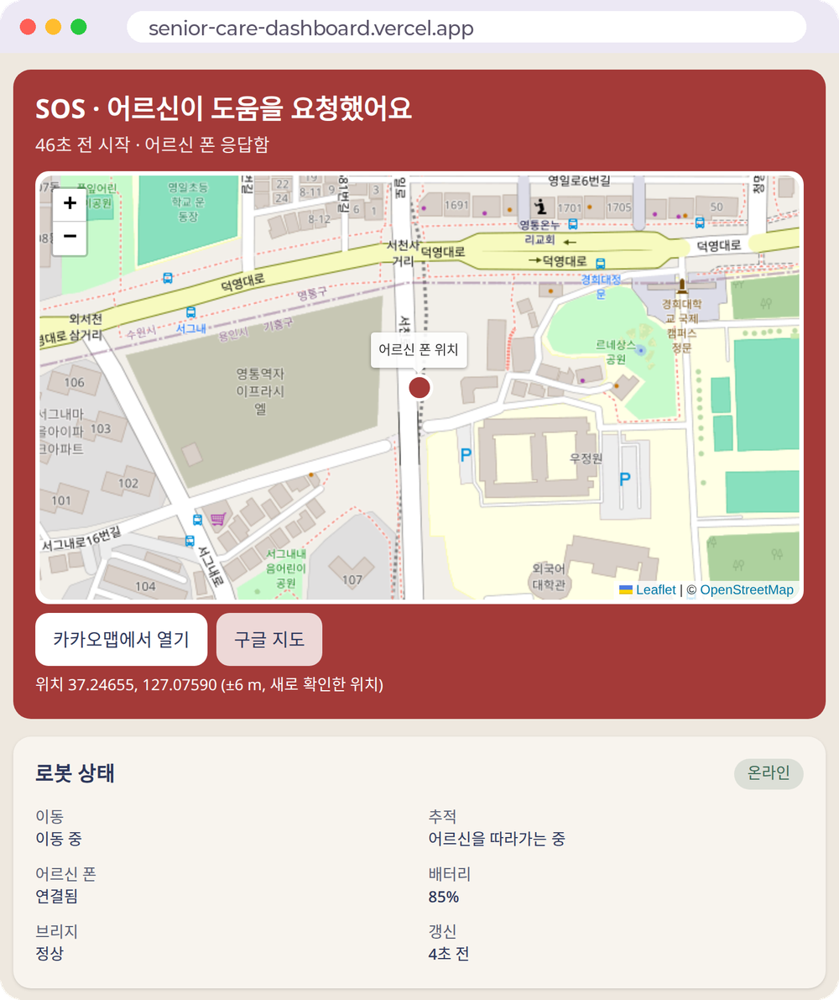

# Senior Care Dashboard

보호자가 보는 웹 대시보드다. 로봇(RPi5)의 `mr_care_telemetry`가 Firebase RTDB에 올린 상태와 이벤트를 실시간으로 보여 주며, 로봇을 조작하지는 않는다.

<p align="center"></p>

어르신이 SOS를 보내면 맨 위에 빨간 카드가 뜨고 어르신 폰 위치가 지도에 찍힌다. 카카오맵이나 구글 지도로 바로 열 수 있다. 알림을 켜 두면 외출 시작과 SOS를 웹 푸시로 받는다. 아이폰은 바탕화면에 추가한 뒤에 알림을 켤 수 있다.

```text
mobile-robot → mr_care_telemetry → Firebase RTDB → React 대시보드
```

Google 계정으로 로그인하고, 로봇마다 볼 수 있는 사람을 따로 정한다. 보호자는 상태, 이벤트, SOS를 보고 `dev` 역할은 진단 탭까지 본다. 진단 데이터는 RTDB 규칙에서도 막아 둔다. 상태가 15초 넘게 갱신되지 않으면 마지막 값을 둔 채 오프라인으로 표시한다. 폰 위치는 SOS가 열려 있는 동안만 보이고, SOS가 끝나면 서버에서 지운다.

## 구조

```text
web/                 Vite + React + TypeScript + Tailwind, Firebase Auth와 RTDB
contracts/           mobile-robot/software/contracts/care-telemetry 사본
scripts/             계약 동기화
database.rules.json  RTDB 보안 규칙 사본
firebase.json        RTDB 규칙과 에뮬레이터 설정
tools/robot-sim/     로봇 시뮬레이터
```

데이터 형식은 [care-telemetry 스키마](contracts/care-telemetry/v1/schema)를 따른다. 계약과 보안 규칙은 [mobile-robot](https://github.com/next-year-robotics/mobile-robot)의 정본에서 가져온다.

## 로컬 실행

Node.js 22와 Firebase CLI가 필요하다.

```bash
cd web
npm ci
cd ..
firebase emulators:start             # 터미널 1
node tools/robot-sim/sim.mjs          # 터미널 2
cd web
npm run dev                         # 터미널 3: http://127.0.0.1:5173
```

에뮬레이터에서 Google 로그인을 하면 권한 안내 화면에 uid가 나온다. 그 uid로 권한을 준다.

```bash
node tools/robot-sim/sim.mjs --grant <uid>
node tools/robot-sim/sim.mjs --grant <uid> --role dev
```

기본값은 Auth와 RTDB 에뮬레이터다. 실제 Firebase에 붙이려면 `web/.env.development.local`에 `VITE_USE_EMULATORS=0`을 넣고, Google 로그인 제공자와 `/access/{robot_id}/{uid}` 권한을 미리 만들어 둔다.

## 시험

```bash
cd web
npm run lint && npm run typecheck && npm test -- --run && npm run build
npx playwright install chromium    # 처음 한 번
npm run test:e2e
```

브라우저 시험은 Auth와 RTDB 에뮬레이터가 떠 있어야 하고, Vite는 알아서 띄운다. `mr-001` 데이터와 시험 계정 권한을 덮어쓰므로 시뮬레이터는 꺼 둔다. 로그인, 권한 회수, 상태, 이벤트, SOS, 진단 화면과 모바일 200% 글꼴을 확인하며 실제 DB에는 쓰지 않는다.

## 배포

```bash
scripts/sync-contracts.sh ../mobile-robot/software/contracts
firebase deploy --only database
```

웹은 Vercel이 배포한다. 프로젝트 `senior-care-dashboard`(루트 `web`, Node 22)가 main에 push될 때마다 https://senior-care-dashboard.vercel.app 에 올리고, PR마다 미리보기를 만든다. Google 로그인은 Firebase Auth 승인 도메인에서만 되므로 미리보기 주소에서는 로그인이 안 된다.

CI는 웹 검사와 함께 정본 계약과의 차이를 본다. 기준은 `mobile-robot/main`이고 저장소 변수 `CONTRACTS_REF`로 바꿀 수 있다.
